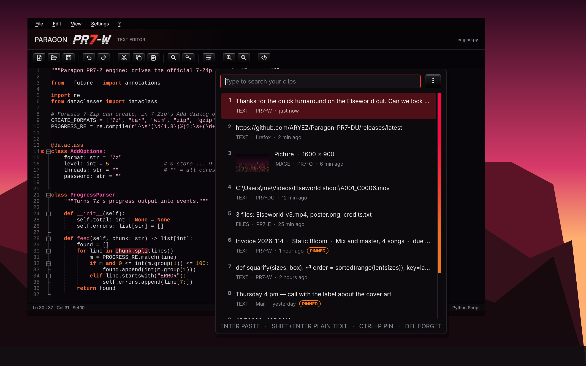

# Paragon PR7-CB

Clipboard history that works the way **Ditto** works, in the Paragon family look (PR7-Z, PR7-W, PR7-L, PR7-F,
PR7-E, PR7-R, PR7-P, PR7-M, PR7-Q, PR7-U, PR7-DU). Python and PySide6.

## What it does

- Runs in the notification area and keeps what you copy: text (with its formatting), pictures and files.
- **Ctrl+`** opens your clips at the text cursor, newest first. Type to search (every word, any case).
  **Enter** pastes into the program you were in, **Shift+Enter** pastes plain text, **Ctrl+1...9** pastes that one,
  **Ctrl+P** pins (pinned clips are never forgotten), **Del** forgets, **Esc** closes.
- Copying the same thing again brings it back to the top instead of keeping it twice.
- **Private copies are never kept**: anything a program marks as private (password managers do: Windows'
  "exclude from monitoring" and "not in clipboard history" marks), and anything copied from a program on the
  "never record" list (PR7-PM, KeePassXC, KeePass, 1Password and Bitwarden to begin with). Pause recording from the
  tray menu.
- Options: the key, how many clips to keep (500), how long (30 days), paste or copy only, where the popup opens,
  plain text by default, pictures, start with Windows.
- The history is a file on your computer (`%APPDATA%\Paragon\PR7-CB\clips.db`); nothing is sent anywhere.

## Building

`pip install -r requirements-dev.txt`, `python -m pytest`, `pyinstaller pr7cb.spec`, then Inno Setup 6 on
`installer/pr7cb.iss`. CI does all of it on Windows; a pushed new version publishes itself.
